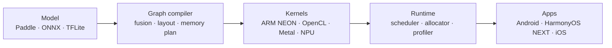
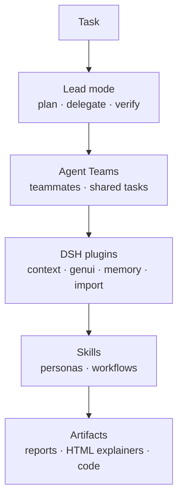

<div align="center">

<p><b>English</b> · <a href="./README.zh-CN.md">简体中文</a></p>



<p>
  <a href="https://xiebaiyuan.com"></a>
  <a href="mailto:xiebaiyuan@foxmail.com"></a>
  <a href="https://www.npmjs.com/package/dsh-lead-mode"></a>
  <a href="https://skills.sh/xiebaiyuan/xiebaiyuan-skills"></a>
  <a href="https://github.com/xiebaiyuan?tab=followers"></a>
</p>

</div>


## About

I build **AI that runs on the device**, from runtime kernels and quantization up to the app a person actually opens. I co-created **[paddle-mobile](https://github.com/xiebaiyuan/paddle-mobile)**, the precursor to [PaddlePaddle/Paddle-Lite](https://github.com/PaddlePaddle/Paddle-Lite), and I still work on the same problem: make a model small and fast enough to live on the hardware in your pocket.

The work now spans three layers that feed each other.

```bash
$ whoami
xie zhibai / 木白 · on-device inference engineer · DSH plugin author
$ cat ~/layers
runtime/      kernels · quantization · graph compilation
agent-layer/  DeepSeek Harness plugins · distilled skills · Agent Teams
apps/         HarmonyOS NEXT · Android · iOS
$ cat ~/rule.txt
measure before you cut, and keep the number reproducible
```


## Now

| Building | What it is |
|---|---|
| [dsh-lead-mode](https://github.com/xiebaiyuan/dsh-lead-mode) | Lead mode for DeepSeek Harness: an agent preset, a working-method skill, a dependency self-check and two preflight reminders that push you to enable Agent Teams. On npm as `dsh-lead-mode` |
| [xiebaiyuan-skills](https://github.com/xiebaiyuan/xiebaiyuan-skills) | My personal agent-skills repo — 12 skills, distilled with nuwa and optimized with darwin |
| [android-crash-diagnose](https://github.com/xiebaiyuan/android-crash-diagnose) | A standalone Android crash-diagnosis skill: collect crash logs, dropbox, tombstone and ANR traces, then turn them into a diagnosis the agent can act on. Freshly split out of my app work |
| AI inference runtime | Operator kernels, INT8/FP16 quantization and graph compilation for mobile SoCs |
| HarmonyOS NEXT apps | Shipped apps under [@xiebyapps](https://github.com/xiebyapps) |


## AI / On-device Inference

The base layer. I have worked on mobile inference since paddle-mobile, and the questions have not changed: how small can the model be, how fast can one kernel run, and does that number still hold on a real phone.

### What I work on

- **Runtime internals** — operator kernels, subgraph partitioning, memory planning, scheduling
- **Execution backends** — ARM (NEON / fp16), GPU (OpenCL / Metal), NPU offline models
- **Model optimization** — INT8 / FP16 quantization (PTQ and QAT), pruning, distillation, graph fusion
- **Profiling and regression gates** — reproducible benchmarks, accuracy and binary-size guards in CI
- **Deployment surfaces** — Android, HarmonyOS, iOS, Linux embedded, RISC-V

<p>
  
  
  
</p>



### Projects

| Project | Role | What it is |
|---|---|---|
| [PaddlePaddle/Paddle-Lite](https://github.com/PaddlePaddle/Paddle-Lite) | Core contributor | Industry-grade mobile inference framework (ARM / OpenCL / Metal / NPU) |
| [paddle-mobile](https://github.com/xiebaiyuan/paddle-mobile) | Co-creator | Original mobile DL runtime that evolved into Paddle-Lite |
| [Paddle-Lite-X](https://github.com/xiebaiyuan/Paddle-Lite-X) | Author | Research fork: low-complexity, high-performance deployment for mobile and embedded |
| [ppocr-java-wrapper](https://github.com/xiebaiyuan/ppocr-java-wrapper) | Author | Production-ready Java wrapper for PaddleOCR on Android |
| [applevision-java-wrapper](https://github.com/xiebaiyuan/applevision-java-wrapper) | Author | Java bridge for Apple's Vision framework |
| [PaddleSelfTools](https://github.com/xiebaiyuan/PaddleSelfTools) | Author | Utility toolchain for Paddle-Lite development and profiling |
| [opencl_cook](https://github.com/xiebaiyuan/opencl_cook) | Author | OpenCL kernel experiments and GPU compute recipes |
| [DogCatTrace](https://github.com/xiebaiyuan/DogCatTrace) | Author | Model-attribution experiment: a fingerprint pipeline with a uniform-random control group |

<p>
  
</p>


## Open Source Contributions

Patches I sent upstream to projects with more than 100 stars, most of them merged.

| Project | Stars | My contribution |
|---|---|---|
| [volcengine/OpenViking](https://github.com/volcengine/OpenViking) | 40,977 | 3 merged PRs — retry the health probe when a gateway redirects to its login (#5984), extra HTTP headers for the Hermes plugin (#5884), carry `OPENVIKING_EXTRA_HEADERS` on the runtime path (#5988) |
| [zxing/zxing](https://github.com/zxing/zxing) | 34,185 | #1839 fix `SYMBOLOGY_IDENTIFIER` loss in `QRCodeMultiReader` |
| [linkwarden/linkwarden](https://github.com/linkwarden/linkwarden) | 20,246 | #1667 add `link-my-harmony` to Community Projects |
| [PaddlePaddle/Paddle-Lite](https://github.com/PaddlePaddle/Paddle-Lite) | 7,288 | 89 merged PRs — HarmonyOS NEXT support (#10654), OpenCL init fixes (#10557), NPE fixes when loading quantized models, op coverage (pixel_unshuffle, fill_constant, search-GAN) |
| [Jeric-X/SyncClipboard](https://github.com/Jeric-X/SyncClipboard) | 5,171 | #325 add the HarmonyOS NEXT client ClipLink |
| [ryanstephen/lil-agents](https://github.com/ryanstephen/lil-agents) | 1,451 | #29 fix dock agents when the dock is on the side |
| [githubhaohao/OpenGLCamera2](https://github.com/githubhaohao/OpenGLCamera2) | 1,089 | #4 fix `FreeNativeImage ppPlane[2] = nullptr` |
| [open-city-ai/haidian](https://github.com/open-city-ai/haidian) | 416 | #161 AI-native city OS proposal for the Jing-Zhang AI Innovation Belt |

<sub>Forks I keep in sync: [RunCatNeo](https://github.com/xiebaiyuan/RunCatNeo) — a fork of [runcat-dev/RunCatNeo](https://github.com/runcat-dev/RunCatNeo) (934 stars), tracked at 0 commits ahead and 0 behind upstream. My fork has no commits of its own.</sub>


## AI Agents & DeepSeek Harness

[DeepSeek Harness](https://github.com/deepseek-ai/deepseek-harness) is a plugin-first agent host: everything is a plugin. I write plugins for it, and I run a fairly deep stack of it every day.



### Plugins I build

| Plugin | What it does |
|---|---|
| [dsh-lead-mode](https://github.com/xiebaiyuan/dsh-lead-mode) | Adds a Lead mode to DSH: an agent preset, a working-method skill (`/skill lead-mode`), a dependency self-check (`/lead-mode`) and two preflight reminders. It touches nothing in the DSH core |

```bash
# install (needs the official Agent Teams runtime enabled)
dsh plugin add dsh-lead-mode
```

### Agent skills I distilled

[xiebaiyuan-skills](https://github.com/xiebaiyuan/xiebaiyuan-skills) holds 12 skills. Some are distilled personas (nuwa), some are the workflows I use every day, all of them are tuned to my own way of working.

| Group | Skills |
|---|---|
| Thinking frameworks | `qian-xuesen-cybernetics-thinking` · `engineering-cybernetics-for-work` · `performance-optimization-carmack-acton` |
| Writing & agent docs | `writing-for-agents-cn` · `de-ai-cn` · `caveman-zh` |
| Research & digests | `model-release-deep-research` · `trendshift-deep-research` · `aihot` · `dsh-plugin-daily` |
| Agent ops & tooling | `lead` · `obsidian-docs-setup` |

Four more skills live outside that repo.

| Skill | Where it lives | What it is |
|---|---|---|
| `mobile-ui-automation` | [xiebaiyuan/mobile-ui-automation](https://github.com/xiebaiyuan/mobile-ui-automation) | Dump a mobile UI tree plus a screenshot, then let the agent write Appium / uiautomator2 / XCUITest / hypium test code |
| `lead-mode` | [xiebaiyuan/dsh-lead-mode](https://github.com/xiebaiyuan/dsh-lead-mode/tree/main/skills/lead-mode) | The working-method skill that ships inside the dsh-lead-mode plugin |
| `android-crash-diagnose` | [xiebaiyuan/android-crash-diagnose](https://github.com/xiebaiyuan/android-crash-diagnose) | Standalone skill for Android crash logs, dropbox, tombstone and ANR traces |
| CN-Claude-Code-Best-Practices | [xiebaiyuan/CN-Claude-Code-Best-Practices](https://github.com/xiebaiyuan/CN-Claude-Code-Best-Practices) | **A translation project.** Chinese translation of a Production-grade Claude Code guide and toolkit — not my own writing |

```bash
# install every skill in the collection into each supported agent runtime
npx skills add xiebaiyuan/xiebaiyuan-skills --all
```


## GitHub Activity

<div align="center">


</div>


## Daily DSH stack

These ten are the third-party plugins my desktop profile loads right now. They are not mine — I use them every day.

| Plugin | Version | What it gives me |
|---|---|---|
| [dsh-context](https://github.com/bowenliang123/dsh-context) | 0.77.0 | Context insight and management, so I can see what is really in the window |
| [dsh-genui](https://github.com/omdsh-dev/dsh-genui) | 0.14.0 | Interactive UI components rendered inline in a reply (npm package `@changfenhuang/dsh-genui`) |
| [OpenViking memory](https://github.com/volcengine/OpenViking) | 0.5.29 | Persistent agent memory, knowledge RAG and skill storage (`@openviking/dsh-memory-plugin`) |
| [answer-me-with-html](https://github.com/QingYunA/answer-me-with-html) | git pin | Turns an answer into a one-page visual HTML explainer |
| [dsh-chat-import](https://github.com/Nwflower/dsh-chat-import) | 0.26.2 | Imports external chat transcripts as continuable sessions |
| [dsh-pet](https://github.com/PC2005-cloud/dsh-pet) | 0.3.8 | A transparent animated desktop pet |
| [dshmarket](https://github.com/dsh-market/dsh-market) | 1.70.2 | Plugin market and updater for the desktop app |
| [dsh-pocket](https://github.com/shaobeichen/dsh-pocket) | 2.12.0 | Pocket utilities and shortcuts inside the host |
| [dsh-fonttune](https://github.com/LyaxZ/dsh-fonttune) | 0.7.1 | Own font, size, line height and weight for the conversation, with saveable presets |
| [subagent-claude-code](https://github.com/deepseek-ai/deepseek-harness) | 0.2.1-rc.3 | Runs a delegated task in a separate Claude Code agent (`@deepseek-ai/dsh-subagent-claude-code`) |


## Self-Hosted

Network infrastructure, DNS tooling and small utilities I actually run at home.

| Project | Description |
|---------|-------------|
| [adguard-home-boost](https://github.com/xiebaiyuan/adguard-home-boost) | AdGuardHome DNS query latency analyzer — P20~P99 per-domain stats |
| [mosdns-dashboard](https://github.com/xiebaiyuan/mosdns-dashboard) | Multi-instance mosdns monitoring dashboard |
| [adrule](https://github.com/xiebaiyuan/adrule) | Ad rules collection and management |
| [work-timer](https://github.com/xiebaiyuan/work-timer) | Simple work time tracker |


## Apps

I build apps that people install and use daily. Main focus: **HarmonyOS NEXT**, then **Android**.

### [@xiebyapps](https://github.com/xiebyapps) — HarmonyOS app studio

| App | Description | Tech |
|-----|-------------|------|
| [ClipLink](https://github.com/xiebyapps/ClipLink) | HarmonyOS client for [SyncClipboard](https://github.com/Jeric-X/SyncClipboard) — clipboard sync across all your devices | ArkTS · ArkUI · HarmonyOS NEXT |
| [link-my-harmony / 鸿笺](https://github.com/xiebyapps/link-my-harmony) | Unofficial HarmonyOS NEXT client for [Linkwarden](https://github.com/linkwarden/linkwarden) bookmark manager | ArkTS · ArkUI · HarmonyOS NEXT |

### Android

| Project | Description |
|---------|-------------|
| [PaddleMobile_Android](https://github.com/xiebaiyuan/PaddleMobile_Android) | Kotlin demo integrating on-device DL inference via paddle-mobile |
| [multisoload](https://github.com/xiebaiyuan/multisoload) | Android JNI multi-SO dynamic loading patterns |
| [android_bitmap_mem_learn](https://github.com/xiebaiyuan/android_bitmap_mem_learn) | Deep-dive into the Android Bitmap memory model |

<p>
  
  
  
  
  
  
</p>


## Engineering Principles

> *"Make it work on the hardest hardware first — everything else is easy after that."*

1. **Measure, then cut** — profile before optimizing, and make the benchmark reproducible.
2. **Hardware sympathy** — align memory layout and computation with what the silicon actually does.
3. **Ship real things** — apps people install, not just numbers in a table.
4. **Open by default** — if it is useful, it belongs on GitHub.
5. **Automate the boring** — CI guards for performance drift, accuracy regression and binary size.


## Contact

- **AI × Mobile** — on-device inference, edge deployment, NPU backends
- **Agent tooling** — DeepSeek Harness plugins, skills, agent-team workflows
- **HarmonyOS ecosystem** — apps, developer tooling, open-source libraries
- **Open benchmarking** — fair, reproducible performance comparisons

**[xiebaiyuan@foxmail.com](mailto:xiebaiyuan@foxmail.com)** · **[木白的芝士小屋](https://xiebaiyuan.com)**


<p align="center"><sub>Updated: 2026-10-27</sub></p>
