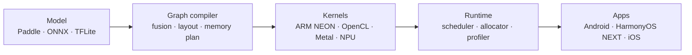
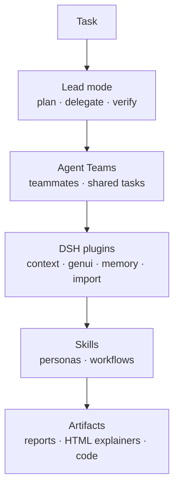

<div align="center">

<p><a href="./README.md">English</a> · <b>简体中文</b></p>


<p>
  <a href="https://xiebaiyuan.com"></a>
  <a href="mailto:xiebaiyuan@foxmail.com"></a>
  <a href="https://www.npmjs.com/package/dsh-lead-mode"></a>
  <a href="https://skills.sh/xiebaiyuan/xiebaiyuan-skills"></a>
  <a href="https://github.com/xiebaiyuan?tab=followers"></a>
</p>

</div>


## 关于

我做**跑在设备上的 AI**。从运行时 kernel、量化，一直到用户真正打开的那个 App。我是 **[paddle-mobile](https://github.com/xiebaiyuan/paddle-mobile)** 的共同作者，[PaddlePaddle/Paddle-Lite](https://github.com/PaddlePaddle/Paddle-Lite) 的前身就是它。我一直在做同一件事：把模型做小、做快，小到能放进你口袋里的硬件。

现在的工作横跨三层，三层互相喂。

```bash
$ whoami
xie zhibai / 木白 · on-device inference engineer · DSH plugin author
$ cat ~/layers
runtime/      kernels · quantization · graph compilation
agent-layer/  DeepSeek Harness plugins · distilled skills · Agent Teams
apps/         HarmonyOS NEXT · Android · iOS
$ cat ~/rule.txt
measure before you cut, and keep the number reproducible
```


## 现在

| 在做的事 | 是什么 |
|---|---|
| [dsh-lead-mode](https://github.com/xiebaiyuan/dsh-lead-mode) | DeepSeek Harness 的 Lead 模式：一个 agent 预设、一个工作方法 skill、一个依赖自检，加两条前置提醒，催你开 Agent Teams。已上 npm，包名 `dsh-lead-mode` |
| [xiebaiyuan-skills](https://github.com/xiebaiyuan/xiebaiyuan-skills) | 我自己的 agent skill 仓库，12 个 skill。用 nuwa 蒸馏，用 darwin 调优 |
| [android-crash-diagnose](https://github.com/xiebaiyuan/android-crash-diagnose) | 独立的 Android 崩溃诊断 skill：收崩溃日志、dropbox、tombstone、ANR 堆栈，转成 agent 能直接动手的诊断。刚从 App 那边拆出来 |
| AI 推理运行时 | 移动端 SoC 上的算子 kernel、INT8/FP16 量化和图编译 |
| HarmonyOS NEXT 应用 | 已上架的应用在 [@xiebyapps](https://github.com/xiebyapps) |


## AI / 端侧推理

这是最底层。从 paddle-mobile 开始我就在做移动端推理，问题一直没变：模型能做多小，一个 kernel 能跑多快，这个数字在真机上还成不成立。

### 我在做什么

- **运行时内部** — 算子 kernel、子图切分、内存规划、调度
- **执行后端** — ARM（NEON / fp16）、GPU（OpenCL / Metal）、NPU 离线模型
- **模型优化** — INT8 / FP16 量化（PTQ 与 QAT）、剪枝、蒸馏、图融合
- **性能分析与回归卡口** — 可复现的 benchmark，CI 里守精度和包体积
- **部署平台** — Android、HarmonyOS、iOS、嵌入式 Linux、RISC-V

<p>
  
  
  
</p>



### 项目

| 项目 | 角色 | 是什么 |
|---|---|---|
| [PaddlePaddle/Paddle-Lite](https://github.com/PaddlePaddle/Paddle-Lite) | 核心贡献者 | 工业级移动端推理框架（ARM / OpenCL / Metal / NPU） |
| [paddle-mobile](https://github.com/xiebaiyuan/paddle-mobile) | 共同作者 | 最初的移动端深度学习运行时，后来长成 Paddle-Lite |
| [Paddle-Lite-X](https://github.com/xiebaiyuan/Paddle-Lite-X) | 作者 | 研究向 fork：面向移动端和嵌入式，低复杂度、高性能部署 |
| [ppocr-java-wrapper](https://github.com/xiebaiyuan/ppocr-java-wrapper) | 作者 | Android 上可直接用的 PaddleOCR Java 封装 |
| [applevision-java-wrapper](https://github.com/xiebaiyuan/applevision-java-wrapper) | 作者 | Apple Vision 框架的 Java 桥接 |
| [PaddleSelfTools](https://github.com/xiebaiyuan/PaddleSelfTools) | 作者 | Paddle-Lite 开发与性能分析的工具链 |
| [opencl_cook](https://github.com/xiebaiyuan/opencl_cook) | 作者 | OpenCL kernel 实验与 GPU 计算示例 |
| [DogCatTrace](https://github.com/xiebaiyuan/DogCatTrace) | 作者 | 模型归因实验：一条指纹流水线，外加一个均匀随机的对照组 |

<p>
  
</p>


## 开源贡献

向上游提交的补丁，项目都在 100 星以上，多数已合并。

| 项目 | Stars | 我的贡献 |
|---|---|---|
| [volcengine/OpenViking](https://github.com/volcengine/OpenViking) | 40,977 | 3 个已合并 PR：网关重定向到登录页时重试健康探测（#5984），给 Hermes 插件加 HTTP 头（#5884），让 `OPENVIKING_EXTRA_HEADERS` 在运行时链路生效（#5988） |
| [zxing/zxing](https://github.com/zxing/zxing) | 34,185 | #1839 修 `QRCodeMultiReader` 丢失 `SYMBOLOGY_IDENTIFIER` |
| [linkwarden/linkwarden](https://github.com/linkwarden/linkwarden) | 20,246 | #1667 把 `link-my-harmony` 加进 Community Projects |
| [PaddlePaddle/Paddle-Lite](https://github.com/PaddlePaddle/Paddle-Lite) | 7,288 | 89 个已合并 PR：HarmonyOS NEXT 支持（#10654），OpenCL 初始化修复（#10557），量化模型加载时的空指针修复，算子覆盖（pixel_unshuffle、fill_constant、search-GAN） |
| [Jeric-X/SyncClipboard](https://github.com/Jeric-X/SyncClipboard) | 5,171 | #325 加 HarmonyOS NEXT 客户端 ClipLink |
| [ryanstephen/lil-agents](https://github.com/ryanstephen/lil-agents) | 1,451 | #29 修 dock 在侧边时的 agent 停靠问题 |
| [githubhaohao/OpenGLCamera2](https://github.com/githubhaohao/OpenGLCamera2) | 1,089 | #4 修 `FreeNativeImage ppPlane[2] = nullptr` |
| [open-city-ai/haidian](https://github.com/open-city-ai/haidian) | 416 | #161 京张 AI 创新带的 AI 原生城市操作系统提案 |

<sub>保持同步的 fork：[RunCatNeo](https://github.com/xiebaiyuan/RunCatNeo) —— 上游是 [runcat-dev/RunCatNeo](https://github.com/runcat-dev/RunCatNeo)（934 星），领先 0 个提交、落后 0 个提交。这个 fork 里没有我自己的提交。</sub>


## AI Agent 与 DeepSeek Harness

[DeepSeek Harness](https://github.com/deepseek-ai/deepseek-harness) 是插件优先的 agent 宿主，一切都是插件。我给它写插件，自己也每天在它上面跑一套挺深的配置。



### 我写的插件

| 插件 | 作用 |
|---|---|
| [dsh-lead-mode](https://github.com/xiebaiyuan/dsh-lead-mode) | 给 DSH 加一个 Lead 模式：一个 agent 预设、一个工作方法 skill（`/skill lead-mode`）、一个依赖自检（`/lead-mode`），加两条前置提醒。DSH 核心一行没动 |

```bash
# 安装（需要先开官方 Agent Teams 运行时）
dsh plugin add dsh-lead-mode
```

### 我蒸馏的 agent skill

[xiebaiyuan-skills](https://github.com/xiebaiyuan/xiebaiyuan-skills) 里有 12 个 skill。一些是用 nuwa 蒸馏的人物视角，一些是我每天用的流程，全都按我自己的做法调过。

| 分组 | Skill |
|---|---|
| 思维框架 | `qian-xuesen-cybernetics-thinking` · `engineering-cybernetics-for-work` · `performance-optimization-carmack-acton` |
| 写作与 agent 文档 | `writing-for-agents-cn` · `de-ai-cn` · `caveman-zh` |
| 调研与简报 | `model-release-deep-research` · `trendshift-deep-research` · `aihot` · `dsh-plugin-daily` |
| Agent 运维与工具 | `lead` · `obsidian-docs-setup` |

另外 4 个 skill 不在那个仓库里。

| Skill | 在哪 | 是什么 |
|---|---|---|
| `mobile-ui-automation` | [xiebaiyuan/mobile-ui-automation](https://github.com/xiebaiyuan/mobile-ui-automation) | 导出移动端 UI 树加截图，让 agent 写 Appium / uiautomator2 / XCUITest / hypium 测试代码 |
| `lead-mode` | [xiebaiyuan/dsh-lead-mode](https://github.com/xiebaiyuan/dsh-lead-mode/tree/main/skills/lead-mode) | dsh-lead-mode 插件里自带的工作方法 skill |
| `android-crash-diagnose` | [xiebaiyuan/android-crash-diagnose](https://github.com/xiebaiyuan/android-crash-diagnose) | 独立 skill，处理 Android 崩溃日志、dropbox、tombstone 和 ANR 堆栈 |
| CN-Claude-Code-Best-Practices | [xiebaiyuan/CN-Claude-Code-Best-Practices](https://github.com/xiebaiyuan/CN-Claude-Code-Best-Practices) | **一个翻译项目。** 一份 Production-grade Claude Code 指南和工具集的中文翻译，不是我写的 |

```bash
# 把整个合集装进每一个支持的 agent 运行时
npx skills add xiebaiyuan/xiebaiyuan-skills --all
```


## GitHub 动态

<div align="center">


</div>


## 日常 DSH 插件

这 10 个是我桌面端 profile 现在装的第三方插件。不是我写的，我每天在用。

| 插件 | 版本 | 它给了我什么 |
|---|---|---|
| [dsh-context](https://github.com/bowenliang123/dsh-context) | 0.77.0 | 上下文观察与管理，能看清窗口里到底装了什么 |
| [dsh-genui](https://github.com/omdsh-dev/dsh-genui) | 0.14.0 | 在回复里直接渲染交互 UI 组件（npm 包 `@changfenhuang/dsh-genui`） |
| [OpenViking memory](https://github.com/volcengine/OpenViking) | 0.5.29 | 持久化的 agent 记忆、知识 RAG 和 skill 存储（`@openviking/dsh-memory-plugin`） |
| [answer-me-with-html](https://github.com/QingYunA/answer-me-with-html) | git pin | 把一个回答变成一页可视化 HTML 讲解 |
| [dsh-chat-import](https://github.com/Nwflower/dsh-chat-import) | 0.26.2 | 把外部聊天记录导入成可继续的会话 |
| [dsh-pet](https://github.com/PC2005-cloud/dsh-pet) | 0.3.8 | 一只透明的桌宠，会动 |
| [dshmarket](https://github.com/dsh-market/dsh-market) | 1.70.2 | 桌面端的插件市场与更新器 |
| [dsh-pocket](https://github.com/shaobeichen/dsh-pocket) | 2.12.0 | 宿主里的快捷工具 |
| [dsh-fonttune](https://github.com/LyaxZ/dsh-fonttune) | 0.7.1 | 对话区自己定字体、字号、行高、字重，预设能存下来 |
| [subagent-claude-code](https://github.com/deepseek-ai/deepseek-harness) | 0.2.1-rc.3 | 把任务丢给一个独立的 Claude Code agent 跑（`@deepseek-ai/dsh-subagent-claude-code`） |


## 自建服务

家里真在跑的网络基础设施、DNS 工具和小工具。

| 项目 | 说明 |
|---------|-------------|
| [adguard-home-boost](https://github.com/xiebaiyuan/adguard-home-boost) | AdGuardHome DNS 查询延迟分析，按域名给 P20~P99 |
| [mosdns-dashboard](https://github.com/xiebaiyuan/mosdns-dashboard) | 多实例 mosdns 监控面板 |
| [adrule](https://github.com/xiebaiyuan/adrule) | 广告规则的收集与管理 |
| [work-timer](https://github.com/xiebaiyuan/work-timer) | 简单的工时记录 |


## 应用

我做的是别人每天会打开的应用。主要做 **HarmonyOS NEXT**，其次 **Android**。

### [@xiebyapps](https://github.com/xiebyapps) — HarmonyOS 应用工作室

| 应用 | 说明 | 技术 |
|-----|-------------|------|
| [ClipLink](https://github.com/xiebyapps/ClipLink) | [SyncClipboard](https://github.com/Jeric-X/SyncClipboard) 的 HarmonyOS 客户端，跨设备同步剪贴板 | ArkTS · ArkUI · HarmonyOS NEXT |
| [link-my-harmony / 鸿笺](https://github.com/xiebyapps/link-my-harmony) | [Linkwarden](https://github.com/linkwarden/linkwarden) 书签管理器的 HarmonyOS NEXT 非官方客户端 | ArkTS · ArkUI · HarmonyOS NEXT |

### Android

| 项目 | 说明 |
|---------|-------------|
| [PaddleMobile_Android](https://github.com/xiebaiyuan/PaddleMobile_Android) | Kotlin 示例，通过 paddle-mobile 做端侧深度学习推理 |
| [multisoload](https://github.com/xiebaiyuan/multisoload) | Android JNI 多 SO 动态加载的几种写法 |
| [android_bitmap_mem_learn](https://github.com/xiebaiyuan/android_bitmap_mem_learn) | 深入 Android Bitmap 内存模型 |

<p>
  
  
  
  
  
  
</p>


## 工程原则

> *"先在最难伺候的硬件上跑通，之后什么都好办。"*

1. **先量再改** — 优化前先 profile，benchmark 要能复现。
2. **顺着硬件来** — 内存布局和计算方式贴着芯片真实的行为走。
3. **做真东西** — 别人会安装的 App，不是表格里的数字。
4. **默认开源** — 有用的东西就该在 GitHub 上。
5. **把无聊的事自动化** — 用 CI 守住性能漂移、精度回归和包体积。


## 联系

- **AI × 移动端** — 端侧推理、边缘部署、NPU 后端
- **Agent 工具** — DeepSeek Harness 插件、skill、agent 团队工作流
- **HarmonyOS 生态** — 应用、开发工具、开源库
- **公开 benchmark** — 公平、可复现的性能对比

**[xiebaiyuan@foxmail.com](mailto:xiebaiyuan@foxmail.com)** · **[木白的芝士小屋](https://xiebaiyuan.com)**


<p align="center"><sub>更新于：2026-10-27</sub></p>
